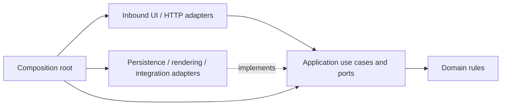

# Architecture

## Layers

`domain` contains pure rules and value objects. `application` coordinates use cases and declares the ports it consumes. `adapters` implement UI, HTTP, persistence, browser scheduling, rendering and integrations. The composition root creates concrete implementations and injects them through ports.

Frontend domain/application code must not depend on React, DOM, Three.js, Rapier, fetch or storage formats. React subscribes to immutable application snapshots through `useSyncExternalStore`; animation poses and frame offsets stay inside rendering adapters. The backend follows the same dependency direction: no HTTP or GORM types in domain rules.

## Repository map

| Path | Responsibility |
|---|---|
| `src/domain/` | Strip construction, target selection, spin plans and client-side validated values |
| `src/application/` | Opening controllers, navigation and application ports |
| `src/adapters/inbound/react/` | Screens and interaction components |
| `src/adapters/outbound/` | API data, browser storage/scheduling, chest/world rendering and audio |
| `src/composition/`, `src/main.tsx` | Frontend dependency composition and runtime ownership |
| `server/internal/domain/` | Existing chest, inventory, wallet and rulebook rules |
| `server/internal/app/` | Existing backend economy orchestration |
| `server/internal/httpapi/`, `server/internal/store/` | HTTP/authentication and database adapters |
| `packages/blockworld/` | Reusable world engine, independent of the application |
| `tools/mc-import/` | Offline schematic importer |
| `tests/`, `server/**/**_test.go` | Executable behavior and boundary checks |

## Context migration

[Bounded contexts and sagas](contexts.md) is the accepted target for autonomous Inventory, Wallet, Identity/Profile and future Shop. There must be no shared transactions, tables, repositories or domain models across those boundaries. Application integration is through consumer-owned ports and translation adapters.

The existing backend is not yet compliant: Inventory imports the wallet aggregate and `app.Economy` uses one persistence transaction for item work and wallet changes. The mutable `wallet_balances` table is not a ledger. This coupling must be removed during the context migration; a directory rename does not accomplish it.

## Runtime ownership

The composition owns application and rendering lifetimes. React effect cleanup may detach a canvas host, but StrictMode must not terminally dispose a shared controller during its development setup/cleanup cycle. Repeated initialization, route changes and stale asynchronous callbacks must not create duplicate schedulers or state changes.

[Opening runtime](opening-runtime.md) defines session recovery and presentation. [World documentation](../worlds/README.md) defines Stage/Guest ownership. These technical rendering objects are not shared business aggregates.

## Validation boundaries

Pure rules run under Node's test runner without browser rendering. UI interaction tests use Happy DOM. Physics tests use real Rapier WASM. TypeScript checks validate separate core and scene boundaries; production build includes them. Backend unit tests and database integration tests validate their respective scopes.

Browser layout, WebGL appearance, GPU execution time, physical-device responsiveness and deployed service health require separate evidence. Passing unit tests does not establish those results.
