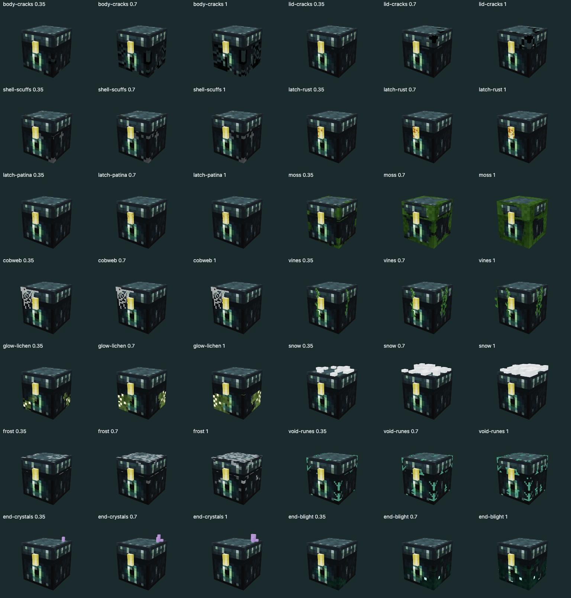
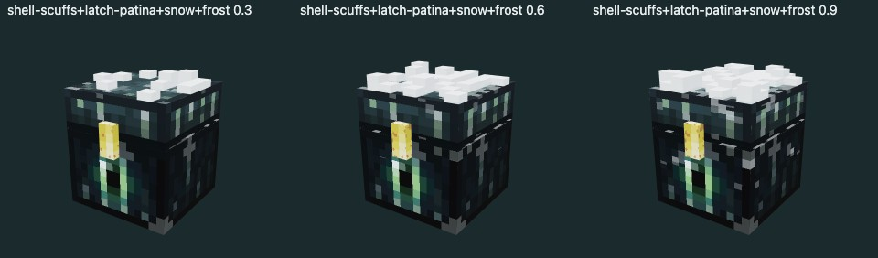
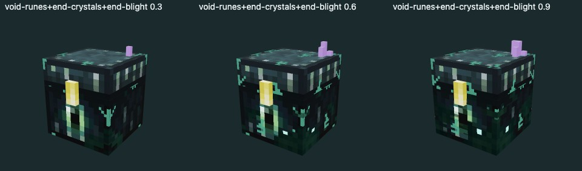
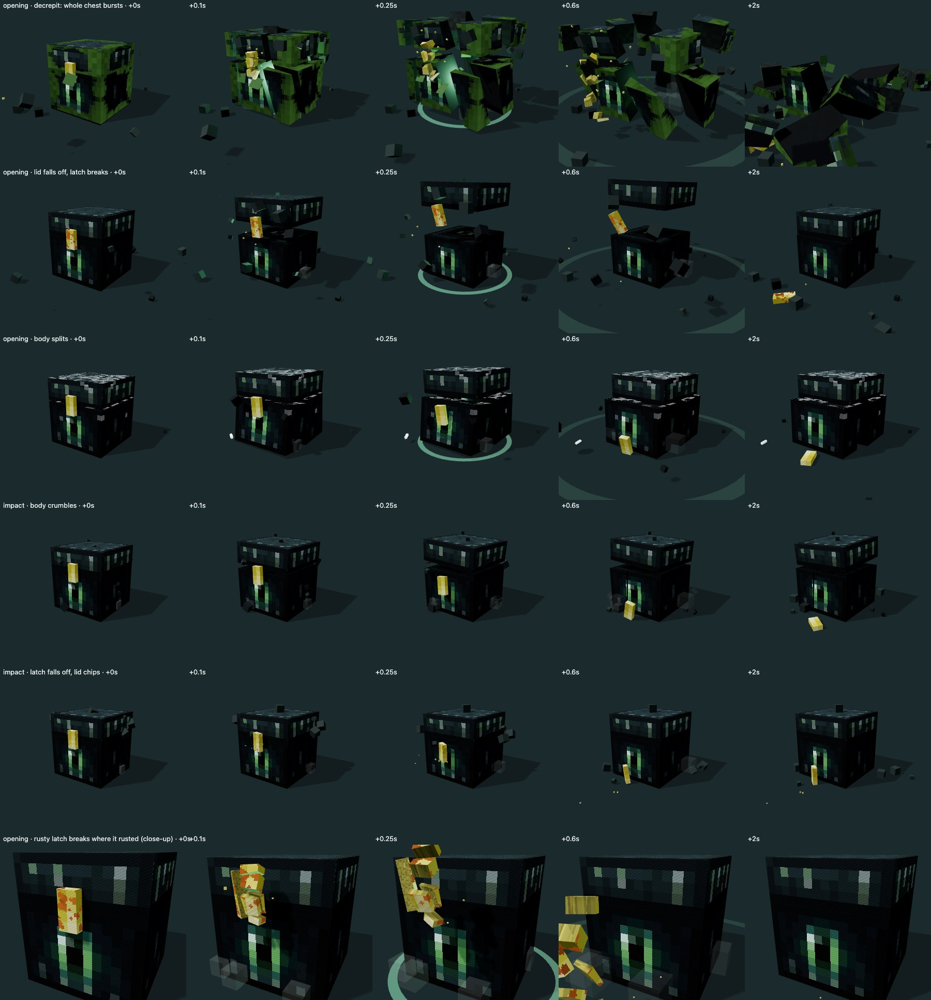

# Chest appearance and breakage

The server owns chest traits and lifecycle outcomes. Presentation profiles translate those values into a model's appearance. Local demo helpers are not authoritative in the API-backed flow.

## Model profile

`ChestModelDefinition.modifications` is checked by `copyModificationProfile` in `src/domain/chest-modifications.ts`.

| Field | Meaning |
|---|---|
| `schemaVersion: 1`, `revision` | Profile format and preview-cache invalidation |
| `parts[]` | Stable part ID, UI label and GLB node names |
| `colorZones[]` | Role `shell/panel/metal/accent`, replace/tint mode, optional strength/material/node selectors |
| `catalog[]` | Stable effect ID, label, kind, applicable parts and style |

Unknown effect kinds are skipped; invalid data for a known kind rejects the profile. Node-specific tinting clones materials rather than mutating shared assets. Model manifests identify required nodes and animation clips by name, not child/clip index.

## Effect styles

`scale` controls pattern density. For the Ender texture density, `scale: 0.25` means one effect pixel per model texel; small parts such as the latch need a different scale. Wear/growth anchoring is `top`, `bottom`, `edges` or `all`.

| Kind | Style and presentation |
|---|---|
| `fracture` | Branches, length, drift, scar color and scale; texel-sized cracks with a chipped edge. Intensity grows the network; impact flashes the instance accent. No fracture entries means no generated cracks. |
| `wear` | Start/end colors, spots, radii, scratches, scale, anchor and opacity; translucent scuffs or opaque rust stages. |
| `glow` | Rune/vein/spark pattern, density, scale, optional color, pulse and brightness; defaults to the instance accent. |
| `growth` | Type, color, scale, anchor, spread, opacity, glow, optional highlight/count. Surface moss/frost/lichen/blight; geometric crystals/vines/cobweb/snow. Count scales with intensity. |

Overlays share model lighting/tone mapping. Geometric front-facing placement derives from the world-facing model orientation rather than assuming every GLB node uses identical local axes. Procedural patterns do not require Mojang textures.

## Instance appearance

```json
{
  "schemaVersion": 2,
  "revision": 4,
  "seed": 302,
  "palette": { "shell": "#3b2e49", "panel": "#574260", "metal": "#6f767c", "accent": "#b76beb" },
  "modifications": [{ "id": "void-runes", "intensity": 0.8, "seed": 1234 }]
}
```

Effect seeds reproduce patterns across previews, opening and fragments. Unknown catalog entries are retained but not rendered. Older `damage.body/lid` saves migrate to crack entries. Visual wear derived from overlays must not replace the server's authoritative condition.

Preview cache keys include model/profile revision and instance appearance. A representative group preview still belongs to an actual instance.

## Breakage result

The client validates breakage with `copyChestBreakage` and renders it in Three.js.

```json
{
  "seed": 2718281,
  "moment": "opening",
  "destroyed": false,
  "parts": [
    { "part": "lid", "severity": 0.6, "detached": true, "pattern": "fall" },
    { "part": "latch", "severity": 0.8, "detached": true, "pattern": "fall" },
    { "part": "body", "severity": 0.5, "detached": false }
  ]
}
```

`destroyed` ends the session without roulette or reward. A detached lid alone does not imply destruction. `impact` draws a mechanical collapse after falling; `opening` draws energy overload, shaking, flash and outward fragments. Destroyed sessions persist as destroyed and recover that outcome rather than rolling again.

Each part has severity `[0,1]` and a detachment flag. Detached patterns are `shatter`, `split`, `crumble` or `fall`. If the load-bearing body is destroyed, remaining attached parts fall with it. `destroyedBreakage` translates server destruction and part state into deterministic client geometry; it does not decide whether the chest survives.

`chest-fracture-geometry.ts` cuts the actual mesh using seeded, mostly axis-aligned planes. Exterior faces preserve UVs; exposed cuts use a texel-scaled fracture texture. Damage masks guide weak points, and overlays continue onto fragments. Rapier handles fragment contacts with the floor, other fragments and surviving chest parts. Debris type follows the effect profile: stone, rust, foliage, ice or sparks.

## Review pages

Run `npm run dev`, then open `/mods-preview.html` for the catalog or `/breakage-preview.html` for breakage. Modification query options include `?ids=moss,cobweb&levels=.3,.9&combo=1`; breakage supports `?seed=`, `?times=0,.4,1.5` and `?nomods=1`. `window.modsSheet` exposes the generated JPEG sheet.

Reference renders are retained as visual evidence, not proof of current browser/device performance:






