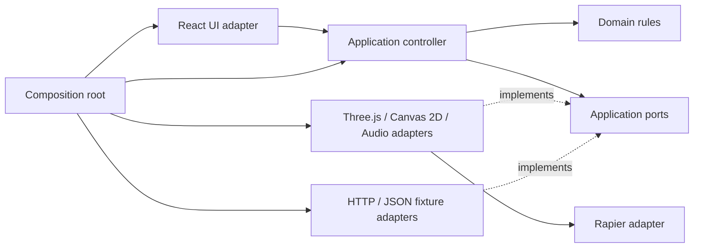
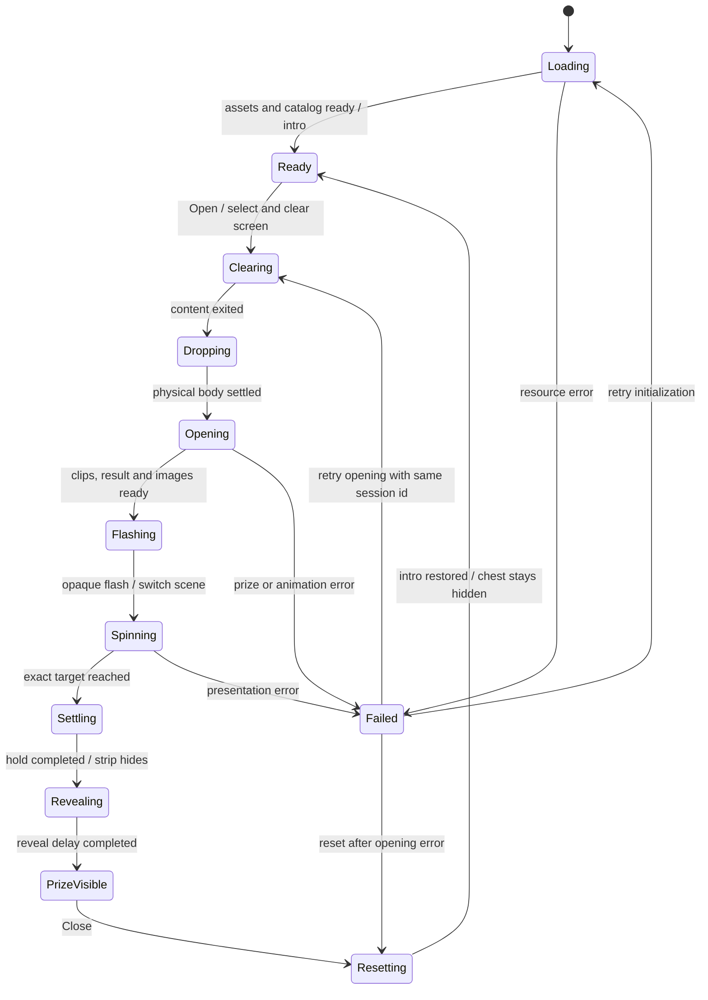

# Hexagonal architecture для MC Roulette

## 1. Граница системы

Ядро описывает открытие сундука, получение результата, подготовку ленты, вращение и повторный цикл. Оно не знает React, Three.js, Rapier, DOM, fetch, requestAnimationFrame или формата старых JSON.

Домен содержит Item, StripSlot, Strip, SpinPlan и чистые правила построения/позиционирования. Application управляет последовательностью операций через порты. UI — входной адаптер; HTTP/fixtures, Three.js, Rapier, Canvas 2D roulette, audio и browser scheduler — выходные адаптеры. Composition root создаёт их и связывает. По решению пользователя Canvas 2D пробуется первым; при неудовлетворительной производительности рулетка переносится в общий Three.js renderer без изменения application ports.



Стрелка implements означает реализацию интерфейса, определённого внутри application; ядро не импортирует адаптер. PhysicsWorldPort — технический контракт внутри подсистемы сцены: приложение работает с ChestPresentationPort, а не управляет collider handles. Это предотвращает попадание геометрии и физического API в бизнес-сценарий.

## 2. Структура

```text
mcroulette/
  src/
    domain/
      item.ts
      strip.ts
      build-strip.ts
      ensure-target.ts
      spin-plan.ts
    application/
      ports/
        catalog-gateway.ts
        prize-gateway.ts
        chest-presentation.ts
        roulette-presentation.ts
        transition-presentation.ts
        random-source.ts
      session-state.ts
      catalog-controller.ts
      chest-preview-controller.ts
      roulette-controller.ts
      errors.ts
    adapters/
      inbound/react/
        App.tsx
        components/
        use-observable-state.ts
      outbound/data/
        fixture-catalog-gateway.ts
        fixture-prize-gateway.ts
        item-dto.ts
      outbound/chest/
        three-chest-drop-scene.ts
        chest-assets.ts
        chest-bounds.ts
        physics-world-port.ts
        rapier-physics-world.ts
      outbound/audio/
        browser-click-audio.ts
      outbound/browser/
        canvas-roulette.ts
        frame-scheduler.ts
        browser-random-source.ts
        transition-presentation.ts
    composition/
      create-application.ts
      presentation-config.ts
      asset-manifest.ts
    main.tsx
  tests/
    domain/
    application/
    integration/
    e2e/
  public/                    # единый набор модели, Draco, иконок, audio, JSON
```

Файлы создаются по мере необходимости; это структура реализации, не требование генерировать пустые классы на каждый объект. Состояние application-контроллера подключается к React через useSyncExternalStore. subscribe стабилен, getState возвращает тот же immutable snapshot до изменения состояния. Локальные UI-состояния хранятся в React; дополнительные store-библиотеки пока не нужны. Архитектура допускает расширение продукта за пределы сундука: отдельные use cases и состояния подключаются через свои входные порты, сохраняя независимость от UI.

Каталог выделен в самостоятельный CatalogController с входным портом ItemCatalog. Он может обслуживать интерфейс до готовности 3D-сцены и другие будущие экраны. Composition root создаёт catalog gateway и передаёт один экземпляр обоим контроллерам. Отмена одного потребителя не отменяет запрос другого; последний отменённый потребитель завершает transport. Production composition теперь создаёт каталог и ChestPreviewController для drop-сцены; игровой режим и preview не могут одновременно владеть одним renderer. Полный RouletteController создаётся при передаче настоящих chest/roulette/transition adapters.

Main владеет сроком жизни Application; initialize вызывается вне React effects. StrictMode не пересоздаёт бизнес-состояние и не уничтожает терминально disposed-контроллер при пробном повторе effect. HMR cleanup сначала размонтирует React, затем освобождает Application. App получает входные порты и callback повторной общей инициализации; об устройстве root и fetch он не знает.

## 3. Модель домена

```ts
type ItemId = string;
type SlotId = string;
type SessionId = string;
type Rarity = 'default' | 'primary' | 'legendary';

interface Item {
  readonly id: ItemId;
  readonly title: string;
  readonly image: string;
  readonly rarity: Rarity;
  readonly displayWeight: number;
}
interface StripSlot {
  readonly id: SlotId;       // уникален даже для одинаковых предметов
  readonly item: Item;
}
interface TargetSelection {
  readonly slots: readonly StripSlot[];
  readonly targetIndex: number; // только 0-based
  readonly prize: Item;
}
interface SpinPlan {
  readonly slotCount: number;
  readonly targetIndex: number;
  readonly fullTurns: number;
  readonly targetOffsetFraction: number; // [-0.4, 0.4]
  readonly deceleration: number;         // конфигурация визуального движения
  readonly timeScale: number;
}
```

Доменные функции получают random-значения/RandomSource явным аргументом. Они не используют Math.random напрямую и не создают DOM. SlotId генерируется из счётчика экземпляров ленты, а не через Item.id; повторный предмет не вызывает конфликт ключей React.

`buildStrip(items, capacity, random)` воспроизводит shuffle → round → cap. `ensureTarget(strip, prize, random)` возвращает immutable массив и валидный targetIndex; metadata выбранного слота обновляется из авторитетного результата. `createSpinPlan(...)` и `positionAt(...)` работают в единицах карточек; pixel-конвертация и DOM-измерения остаются в roulette adapter. План включает start/end position, distance и durationSeconds, чтобы поздний кадр гарантированно фиксировал рассчитанную конечную позицию.

Инварианты: неотрицательное число карточек; prize и target slot совпадают по id; целевой index меньше длины; jitter внутри карточки; один авторитетный result на сессию. Rarity/weights не определяют result. Поля DTO валидируются на границе; domain также проверяет свои предпосылки при прямом вызове.

## 4. Application ports

Ниже TypeScript-контракты для реализации. Типы AbortSignal и функции подписки допускаются на application-уровне; domain остаётся чистым. При необходимости среды без AbortController cancellation заменяется собственным token.

```ts
interface CatalogGateway {
  load(signal: AbortSignal): Promise<readonly Item[]>;
}
interface PrizeGateway {
  select(sessionId: SessionId, signal: AbortSignal): Promise<Item>;
}
interface RandomSource {
  next(): number; // конечное значение в [0, 1)
}
interface ChestPresentationPort {
  prepare(signal: AbortSignal): Promise<void>;
  drop(signal: AbortSignal): Promise<void>; // resolve после физического приземления и settling
  open(signal: AbortSignal): Promise<void>; // resolve после всех обязательных клипов
  hide(): void;
  reset(signal: AbortSignal): Promise<void>;
  dispose(): void;
}
interface RoulettePresentationPort {
  prepare(signal: AbortSignal): Promise<void>; // mount, assets, optional audio
  spin(selection: TargetSelection, plan: SpinPlan,
       signal: AbortSignal): Promise<void>; // resolve при точной остановке
  reset(): void;
  dispose(): void;
}
interface TransitionPresentationPort {
  clearContent(signal: AbortSignal): Promise<void>;
  flashToRoulette(signal: AbortSignal): Promise<void>;
  finishFlash(signal: AbortSignal): Promise<void>;
  holdStoppedStrip(signal: AbortSignal): Promise<void>;
  revealPrize(signal: AbortSignal): Promise<void>;
  resetToIntro(signal: AbortSignal): Promise<void>;
  dispose(): void;
}
```

TransitionPresentationPort реализует отменяемые задержки/анимации из конфигурации, сообщает state для отображения и не выбирает выигрыш. Методы допускают reduced-motion без изменения правил. Физические frames, звук и loading progress не проходят через общий application event bus.

Входной порт контроллера:

```ts
interface RouletteSession {
  initialize(): Promise<void>;
  openChest(): Promise<void>;
  closePrize(): Promise<void>;
  retry(): Promise<void>;
  resetAfterError(): Promise<void>;
  getState(): SessionState;
  subscribe(listener: () => void): () => void;
  dispose(): void;
}
```

UI только вызывает методы и отображает state. Контроллер владеет единственным активным AbortController, sessionId, каталогом, постоянной лентой и immutable state snapshot. В port adapter не дублируется application state machine.

## 5. Состояния и orchestration



Все async-переходы Settling/Revealing/Resetting также могут перейти в Failed при неотменяемой ошибке. Любое состояние переходит в Disposed при dispose; cancellation сама по себе не является пользовательской ошибкой.

State — discriminated union с payload каждого состояния, а не набор show/isOpen/isLoaded. Например PrizeVisible содержит Item и sessionId; Failed содержит понятный error code, recoverable action и предыдущую стабильную фазу. State хранит только сериализуемые данные; DOM nodes, mesh и Rapier World в него не входят.

`initialize`: параллельно загрузить каталог и подготовить presentation adapters; построить persistent strip; скрыть сундук и выставить Ready. Падение начинается только после Open и clearing. Ошибка обязательного ресурса отменяет соседние операции и переводит в Failed.

`openChest`: только из Ready, синхронно сменить состояние до первого await; создать sessionId/token; параллельно select и open; после успешного select выполнить ensureTarget. Барьер Promise.all гарантирует, что spin стартует только после готовности обоих результатов. При ошибке отменить оставшуюся работу, сохранить результат успешного select для безопасного retry, если он уже получен. Адаптеры обязаны обрабатывать signal и не давать late callback менять новый state.

`spin`: прогреть картинки, поднять вспышку, на её пике скрыть сундук и переключить сцену; одновременно запустить spin и спад вспышки. Затем ждать точную остановку, пройти Settling/Revealing и установить PrizeVisible. Предмет берётся из selection.prize. Несовпадение renderer target с selection считается ошибкой реализации.

`closePrize`: только из PrizeVisible; перейти в Resetting; reset renderer offsets, reset chest, провести transition, начать drop, вернуть Ready. Persistent strip сохраняется. Повторные команды во время Resetting не запускают второй reset.

`retry`: из Failed выполняет только объявленный recoverable action. Если select уже вернул Item, повторить presentation без нового select. При транспортной ошибке demo fixture запрос можно повторить; для будущего HTTP backend использовать тот же sessionId/idempotency key, чтобы неизвестный результат первого запроса не породил вторую выдачу. Это контракт будущего адаптера, не добавление backend сейчас.

`dispose`: атомарно пометить Disposed, отменить операции, очистить subscriptions, вызвать dispose adapters ровно один раз. Любая завершившаяся после этого операция проверяет token/session generation перед state update. Состояние Disposed терминальное.

## 6. Технические адаптеры

**Data.** fetch с AbortSignal, проверка HTTP status и JSON schema; единственный cache/in-flight catalog. Prize fixture не кэшируется между sessionId. item-dto.ts является единственным местом знания старых полей chance/type. Не нужна axios ради двух GET.

Legacy-пути `/static/...` разрешаются внутри deployment base URL, а абсолютные HTTP(S) URL сохраняются. Prize gateway использует `cache: no-store`. Отмена ожидания поддерживается и для транспорта, игнорирующего signal; поздняя отменённая загрузка не записывает данные в кэш. Корневой каталог неизменяем, ошибки не кэшируются.

**Three chest.** Asset loader и cache, один renderer и камера, одна визуальная иерархия с двумя режимами drop/opening. Asset manifest связывает семантические имена с GLB; lookup по имени. AnimationMixer завершает clips через события finished; reset снимает обработчики, останавливает actions и возвращает исходные transforms. Новый экземпляр не наследует mutable userData mixers от clone.

**Physics.** Адаптер владеет Rapier World и typed mapping bodyId → mesh. PhysicsWorldPort содержит create/reset/step/readPose/dispose с простыми Vec3/Quat DTO; не возвращает Rapier types. Численная калибровка и debug colliders находятся здесь. Подробности — physics-decision.md.

**Frame scheduler.** В штатной последовательности активен один RAF: обновляет физику в drop, mixer в opening, roulette при spin либо transition. Адаптеры владеют своими scheduler/visibility subscriptions и снимают их на dispose. Нет собственного бесконечного loop на каждую reset-сцену. FrameTimeline обслуживает отменяемые transitions; fake scheduler используется в тестах адаптеров.

**Roulette.** CanvasRoulette реализует RoulettePresentationPort. Один видимый Canvas 2D рисует размытый фон и резкую увеличенную ленту внутри круговой маски, используя один logical offset. Карточки и размытие кэшируются в отсоединённых canvas; frame loop рисует только видимое окно через drawImage. Маска воспроизводит circle(15%) исходного CSS с увеличением 1.2. DPR ограничен двумя; cache обрезается по актуальному strip и освобождается на dispose. Картинки загружаются до начала spin с cancellation и retry; поздний ответ старой операции не меняет новую. Старт/остановка, размеры, курсор и jitter скрыты за presentation port. React монтирует canvas, но не управляет его кадрами.

**Audio.** Optional resource; readiness/failure не блокируют модель и каталог. Ограниченный pool; dispose освобождает nodes/AudioContext/object URLs, если использованы. После tab resume не воспроизводит пропущенные clicks.

**UI.** React-компоненты Catalog, Open, loader, win и error подписываются на application state. React владеет контейнерами canvas/ленты, а адаптеры — их внутренними узлами: оба слоя не изменяют одни и те же DOM-элементы. Покадровые poses/offsets не передаются через React state. Mount/cleanup должны выдерживать повторный setup в StrictMode; терминальный dispose не должен ломать повторное создание приложения. Фокус кнопок сохраняется; Open/Close имеют ясные disabled-состояния. Circle заменяется SVG/CSS без изменения композиции. Mobile layout воспроизводит исходную сетку и прокрутку; новая функциональность Close Catalog не добавляется.

## 7. Перенос старых модулей

| Старый модуль | Новая ответственность |
| --- | --- |
| store/modules/default.ts | buildStrip/ensureTarget + CatalogGateway/PrizeGateway + application state |
| Item.ts | domain Item и DTO validator |
| Chest.ts | orchestration в controller, presentation в ThreeChestPresentation |
| ChestPhysicalScene.ts | RapierPhysicsWorld + drop-mode chest adapter |
| ChestDefaultScene.ts | opening-mode chest adapter |
| ScaleMove.ts | time-based ChestMotion |
| Roulette.ts | pure spin plan + CanvasRoulette adapter |
| ListManager.ts / Prize.ts | StripSlot и rendering layout без DOM в domain |
| event/index.ts / EventName.ts | прямые команды controller, state subscription, локальные adapter callbacks |
| services.ts / bootstrap.ts | composition/create-application.ts |
| Loader.vue | UI loading state и progress adapter |
| ChestInsides.vue / WinScreen.vue | UI-компоненты без orchestration |
| Circle.vue | CSS/SVG presentation |

## 8. Порядок реализации

1. Получить воспроизводимый legacy build в отдельном окружении с подходящим Node и согласованным yarn lock. Не смешивать этот шаг с обновлением Three.js. Записать эталон сценария. Если запуск недоступен, продолжить чистое ядро, но не объявлять визуальный паритет достигнутым.
2. Создать новую реализацию в корне ветки `rewrite-react-rapier`, один package manager, strict TS; по мере реализации перенести нужные public assets из `master` с учётом base URL и лицензии GPL-3.0-or-later. Проверить GLB/Draco отдельно.
3. Реализовать domain и controller с fake gateways/presentation. Проверить инварианты ленты, все переходы, race/cancel/retry.
4. Подтвердить Rapier минимальной сценой, размеры и transforms collider; production build и resource cleanup. Этот этап подтверждает ADR.
5. Подключить Three chest и GLB opening; подключить Canvas 2D roulette и audio; собрать UI через composition root.
6. Выполнить критерии из behavior.md, запись сравнения и браузерные тесты. Проверить cold cache, errors, tab pause, resize, 100 циклов, подкаталог deployment.
7. После приёмки подготовить ветку к слиянию; сохранить исходный commit как архивный эталон. Обновить README, asset manifest и решения архитектуры. Старые пакеты и lock-файлы не возвращать.

## 9. Тесты и границы

Для domain/application используется встроенный Node test runner с type stripping, без дополнительных пакетов. Fixed/seeded random проверяет вставку отсутствующего результата, массив совпадений, 39-карточный каталог и King, нулевые веса и неверные Item. Fake ports проверяют задержку select относительно open, повторный Open/Close, abort, late completion и retry с сохранённым result. Type stripping не заменяет tsc; domain имеет отдельный tsconfig без DOM. [Node TypeScript](https://nodejs.org/api/typescript.html), [test runner](https://nodejs.org/api/test.html).

UI проверяется React server renderer и реальным React DOM в Happy DOM: состояние загрузки, ошибки, Retry, useSyncExternalStore, StrictMode mount/unmount и команды игрового UI. Happy DOM — только devDependency; он не включается в runtime bundle. Это не заменяет проверку layout/WebGL в настоящем браузере. [Happy DOM](https://github.com/capricorn86/happy-dom/wiki/Getting-started).

Integration проверяет реальный Rapier step/reset/free и mapping poses без требования pixel-identical физики разных платформ. Browser tests (Playwright) проверяют user cycle, выбранный id под курсором, ошибки ресурсов, viewport и повторный mount/unmount. Instrumentation считает активные bodies/listeners/schedulers; память оценивается по стабилизации после прогрева, не по нереалистичному требованию нулевого роста browser heap.

Автоматическая проверка импортов запрещает domain/application импортировать adapters, react, react-dom, three, Rapier и DOM-модули. Для domain дополнительно исключить DOM types из tsconfig. Production build включает tsc --noEmit. Порты не тестируются зеркальными mock-assertions ради покрытия: тестируются правила, sequencing и failure cases.

Источники по выбранному стеку: [React external state](https://react.dev/reference/react/useSyncExternalStore), [Vite](https://vite.dev/guide/), [Three.js migration guide](https://github.com/mrdoob/three.js/wiki/Migration-Guide), [Rapier](https://rapier.rs/docs/user_guides/javascript/getting_started_js/). Версии и браузерные ограничения фиксируются по реально установленному комплекту при реализации.

## Текущая drop-сцена

ChestPreviewController — отдельный входной порт подготовки/повторного падения, не заменяющий game session. ThreeChestDropScene реализует ChestDropPort и владеет canvas, GLTF resources, renderer, Rapier adapter, ResizeObserver и FrameScheduler. UI получает preview-порт и внешний DOM host; ref cleanup в StrictMode только отсоединяет host, а ресурсами владеет Application.

PhysicsWorldPort использует plain Vec3/Quat/BoxCollider/Pose; Rapier types остаются внутри реализации. Два боксовых коллайдера вычисляются из реальных bounds корпуса/крышки; скрытый Key исключён. Одна нормализация масштаба и центра применяется и к mesh hierarchy, и к collider offsets. Матрицы GLB и клипы сохраняются для следующего этапа открытия.

FixedStepper ограничивает физику пятью шагами по 1/60 секунды; FrameScheduler содержит одну visibility subscription и один RAF. Pause/resume обнуляет временной остаток, а generation token отсекает отменённый callback. Ошибки рендера и context loss освобождают ресурсы и переходят в failed preview с Retry. Reset переиспользует renderer/assets/world, удаляя только старое dynamic body с его collider children.

Draco decoder генерируется из установленного Three.js scripts/sync-draco.mjs; static URL учитывает base path. Проверка через настоящий Rapier WASM выделена в test:physics и не заменяется mock-физикой. Текущий статус проверок:.
