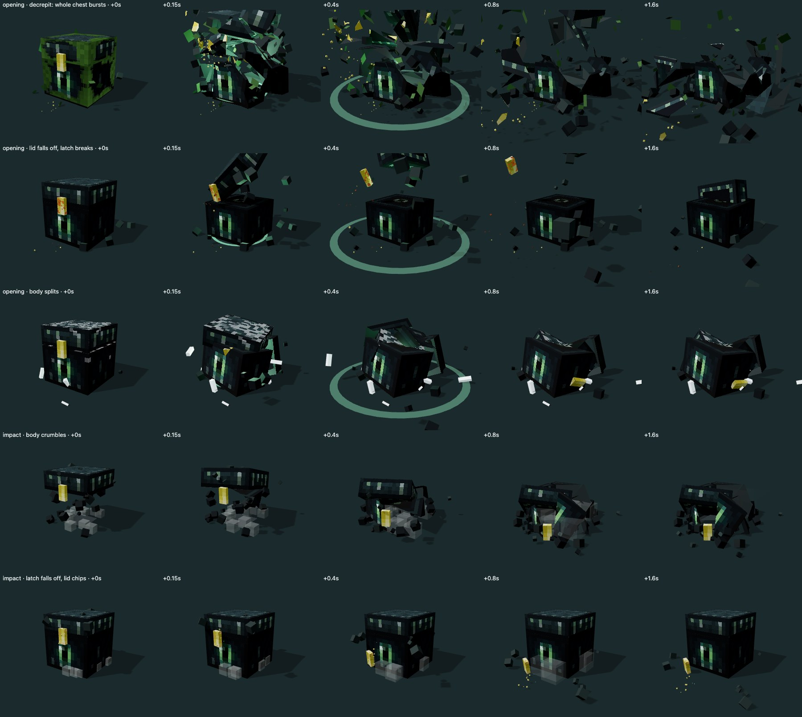

# Разрушение сундука: контракт сервер → клиент

Сервер по типу кейса и его характеристикам случайно решает, сломается ли сундук и как; клиент проверяет (`copyChestBreakage`, `src/domain/chest-breakage.ts`) и рисует в three.js. Обоснование в игре: сундук не выдерживает мощности энергии.

```json
{ "seed": 2718281, "moment": "opening", "destroyed": false,
  "parts": [ { "part": "lid", "severity": 0.6, "detached": true, "pattern": "fall" },
             { "part": "latch", "severity": 0.8, "detached": true, "pattern": "fall" },
             { "part": "body", "severity": 0.5, "detached": false } ] }
```

- `destroyed` — сундук не выдержал: **рулетки нет, награды нет**, показывается сообщение «Сундук не выдержал» поверх обломков. Отвалившаяся крышка сама по себе не разрушение; в демо разрушен тот, у кого разлетелся корпус. Требует хотя бы одной отделённой части.
  - при `impact` сессия заканчивается сразу после падения — открывать нечего;
  - при `opening` проигрывается перегрузка и взрыв, затем сообщение.
  - Экземпляр получает статус `destroyed` (без награды, попадает в архив как «Разрушен»); журнал сессии хранит `stage: destroyed`, после перезагрузки сообщение восстанавливается, а не разыгрывается заново.
- `moment` — два разных сценария:
  - `impact`: механика удара после падения — части оседают и сползают по земле, пыль у пола;
  - `opening`: перегрузка энергией — сундук набухает, дрожит и разгорается цветом акцента, затем вспышка, кольцевая волна по полу, обломки разлетаются во все стороны.
- `parts[]` — своя судьба у каждой части профиля: корпус может разрушиться, крышка — отвалиться, замок — сломаться. `severity` 0..1 — сколы и число обломков; `detached` — часть отделяется.
- `pattern` отделённой части: `shatter` (много обломков, разлёт), `split` (2–4 крупных), `crumble` (осыпается сверху вниз), `fall` (отваливается целиком, вместе с мхом/ржавчиной/кристаллами).
- Ветхий сундук: все части `detached` — разваливается/взрывается целиком. Если разрушен несущий корпус (первая часть профиля), остальные части падают вместе с ним.
- `seed` задаёт геометрию: разлом считается математически — сеянные плоскости, близкие к осям стенок (камень и доски колются блоками, без стеклянных клиньев), режут настоящий меш на цельные выпуклые куски: снаружи текстура сундука с исходными UV, на изломе фактура сколотого камня в размер текселя (`chest-fracture-geometry.ts`). Каждый раз иначе; одна сессия — один и тот же разлом.
- Разлом идёт по повреждениям: ржавчина, трещины и износ части — слабые места, плоскости проходят через них (те же маски, что рисуют эти эффекты). Ржавый замок раскалывается по ржавчине; повреждённая часть даёт больше кусков. Оверлеи (ржавчина, мох, трещины) продолжаются на внешних гранях кусков.
- Движение — настоящая физика Rapier: тяжёлые куски сталкиваются с полом, друг с другом и с уцелевшими частями (отвалившаяся крышка падает на корпус), ложатся на грань.
- Что ещё летит — зависит от модификаций части (поле `debris` записи каталога, иначе по виду): каменная крошка, рыжие хлопья ржавчины, листья мха, ледяные осколки, искры рун.

Пока сервера нет, исход считает `demoBreakage` (`src/adapters/outbound/browser/demo-breakage.ts`) из состояния частей экземпляра; судьба закреплена за экземпляром.

Эталон (`/breakage-preview.html`, `?seed=` меняет разлом, `?times=0,.4,1.5`, `?nomods=1`):


