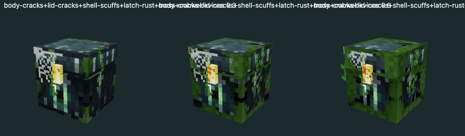

# Модификации сундуков: контракт сервер → клиент

Сервер настраивает и выдаёт всё; клиент только проверяет данные и рисует. Пока сервера нет, профиль Ender лежит в `src/config/ender-modifications.ts`, а демо-экземпляры — в `demo-inventory-store.ts`. Это ровно те JSON, которые потом придут по сети.

## Профиль модели (`ChestModelDefinition.modifications`)

Проверяется `copyModificationProfile` (`src/domain/chest-modifications.ts`).

- `schemaVersion: 1`, `revision` — меняется при любом изменении профиля (сбрасывает кеш превью).
- `parts[]` — `{ id, label, nodes[] }`: части модели и узлы GLB. `label` показывается в UI («Корпус», «Крышка», «Замок»).
- `colorZones[]` — `{ role, mode, strength?, materials?[], nodes?[] }`. `role` ∈ shell/panel/metal/accent. `replace` ставит цвет материала (нейтральные серые текстуры), `tint` смешивает светлую версию оттенка с белым на `strength` (окрашенные текстуры). Зоны по узлам получают свою копию материала.
- `catalog[]` — `{ id, label, kind, parts[], style }`. Неизвестный `kind` клиент пропускает; ошибки в известных видах отклоняют весь профиль.

### Стили

Общее: `scale` — плотность узора. **`scale: .25` = один пиксель эффекта на тексель модели** (текстура Ender — 16 px на единицу); это базовое значение, иначе эффект выглядит гладко и «не по-майнкрафтовски». Маленьким частям (замок) нужен больший `scale` (2), иначе на них попадает лишь край узора.

`anchor` (wear, growth) — где эффект начинается: `top`, `bottom`, `edges` (рёбра и углы), `all`.

| kind | style | как рисуется |
|---|---|---|
| fracture | branches, minLength, maxLength, drift, scarColor, scale | ломаные ветвистые трещины в один тексель с односторонним светлым сколом. Интенсивность = насколько разрослась сеть. При ударе раскрываются и вспыхивают цветом акцента. Модель без fracture-записей не трескается |
| wear | color, colorEnd?, spots, minRadius, maxRadius, scratches, scale, anchor, opacity | пятна и царапины; поздние пятна уходят в `colorEnd` (стадии ржавчины/окисления). opacity: потёртость полупрозрачна (~.4), ржавчина — корка (~.9) |
| glow | pattern (runes/veins/sparks), density, scale, color?, pulse, brightness | высеченные светящиеся знаки, не аддитивный неон. Без color — акцент экземпляра |
| growth | type, color, scale, anchor, spread, opacity, glow, highlight?, count | поверхность: `moss` (кочки, тёмные корни/светлые кончики), `frost` (россыпь кристалликов), `lichen` (ковёр со светящимися точками `highlight`), `blight` (тёмная порча с редкими огоньками). Геометрия: `crystals` (воксельные друзы у заднего края), `vines` (пряди с верхнего края фасада/боков), `cobweb` (сеть в верхних углах), `snow` (бугристый слой столбиков 2×2 текселя); `count` × интенсивность = количество |

Оверлеи освещаются фиксированным ключевым светом и проходят tone mapping/sRGB, как сама модель. «Фасад» для геометрии берётся из мира (сундук смотрит на камеру), а не из локальных осей узла: узлы Blockbench повёрнуты по-разному.

## Каталог Ender: эффекты рассказывают историю сундука

Эффекты вдохновлены знакомыми блоками Minecraft; все текстуры генерируются, ассеты Mojang не используются.

| группа | записи | смысл |
|---|---|---|
| повреждения | body-cracks, lid-cracks, shell-scuffs, latch-rust, latch-patina | интенсивность = состояние части в UI |
| старение | moss, cobweb, vines, glow-lichen | давно лежащий сундук |
| погода | snow, frost | |
| Край | void-runes, end-crystals, end-blight | мистика, не зависит от состояния |

Эталонные рендеры (уровни 0.35/0.7/1 и наборы 0.3/0.6/0.9):





Просмотр вживую: `npm run dev` → `/mods-preview.html` (весь каталог), `?ids=moss,cobweb&levels=.3,.9`, `&combo=1` (всё на одном сундуке). Готовый лист доступен как `window.modsSheet` (JPEG data URL) — так агент может смотреть результат без скриншотов.

## Экземпляр (`CaseInstance.appearance`, schemaVersion 2)

```json
{ "schemaVersion": 2, "revision": 4, "seed": 302,
  "palette": { "shell": "#3b2e49", "panel": "#574260", "metal": "#6f767c", "accent": "#b76beb" },
  "modifications": [ { "id": "void-runes", "intensity": 0.8, "seed": 1234 } ] }
```

- `id` — запись каталога модели; `intensity` ∈ (0, 1]; `seed` фиксирует форму узора везде.
- Записи, которых нет в каталоге модели, сохраняются, но не рисуются.
- Состояние частей в UI = максимум интенсивности fracture/wear, покрывающих часть.
- Сохранения v1 (`damage.body/lid`) переводятся в `body-cracks` / `lid-cracks`.

## Что пока решает клиент (демо)

- Удар при падении поднимает все fracture-записи модели до 0.9 (`withImpactDamage`).
- Демо-выдача сначала выбирает состояние: от него зависят повреждения и вероятность старения; погода и Край — независимые редкие черты.

С сервером оба решения принимает сервер.
