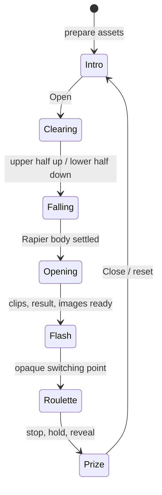

# Итерация 08: сцены экрана и переходы

## Разделение

Один источник состояния — RouletteController. IntroScene владеет исходным содержимым и кнопкой, ChestScene — 3D host и декорацией падения, RouletteScene — Canvas host, PrizeScene — результатом. GameViewport компонует сцены; screen-scene.ts задаёт единственную активную сцену для каждой application phase. Неактивные 3D/Canvas hosts скрыты, но сохраняются для переиспользования ресурсов. Intro DOM удаляется после завершения выезда. Сцены не вызывают методы друг друга.

PresentationHost только монтирует внешний element и отсоединяет его при StrictMode cleanup. Renderer/WASM/image cache принадлежат composition root и адаптерам. Покадровые координаты не передаются через React.

## Сценарий

Initialize больше не запускает падение. Open создаёт session id и параллельно запрашивает приз и запускает presentation pipeline. Верхняя половина IntroScene уезжает вверх, нижняя с каталогом/кнопкой — вниз; граница на 50svh. Длительность 0.55 s задана общей presentation-константой для CSS и GameTransitions.

После clearing контроллер вызывает chest.drop. Его promise завершается при фактическом Rapier isSleeping. Предел 15 секунд симулированного времени приводит к recoverable error, а не успешному открытию по таймеру. Hidden time не начисляется. Контракт: [Rapier RigidBody.isSleeping](https://rapier.rs/javascript3d/classes/RigidBody.html#isSleeping).

Затем chest.open ждёт finished обоих clips. До вспышки prepareSpin подготавливает картинки, чтобы холодная загрузка не оставила пустой экран после перехода. GameTransitions поднимает вспышку за 0.12 s; на непрозрачном пике скрывается ChestScene и включается RouletteScene. Spin и спад вспышки 0.3 s стартуют вместе. Две visual scenes не отображаются одновременно; только transition timeline кратко работает вместе с RAF рулетки.

Close возвращает IntroScene за 0.5 s и сбрасывает/скрывает сундук. Следующее падение снова начинается по нажатию. Reduced motion отключает разъезд и белую вспышку, сохраняя порядок состояний.

## Линза

Нижняя размытая лента рисуется с evenodd clip: viewport минус круг линзы. Резкая — только внутри круга. Поэтому нижняя лента не просвечивает в прозрачных частях карточек или зазорах внутри линзы. Декоративное кольцо с полукругом остаётся только в Falling.

## Проверки

82 базовых и 25 React/Canvas-тестов проходят. Новые barriers проверяют clearing → landing → clips → warm images → flash → spin, отсутствие раннего падения/вспышки, отмену при падении и retry с тем же session id. Happy DOM проходит два полных цикла с настоящими controller, fixture gateways, CanvasRoulette и GameTransitions; chest — управляемый тестовый порт. Проверяются исключительная видимость сцен, декорация только при падении, сохранение hosts, focus и возврат к Intro без нового падения.

Отдельно проверены непрозрачный пик вспышки, её спад, reduced motion и outside/lens clip regions. Recording context не растеризует пиксели. TypeScript 6.0.3, React 19.3.0 и Happy DOM 20.14.5 восстановлены из кэша в /tmp; browser/core adapters и React проходят типизацию.

Изменённый Three.js/Rapier код прошёл только syntax check. Интеграционный Rapier-тест дополнен проверкой sleeping, но не исполнен: зависимости отсутствуют, npm ping снова ENOTFOUND. GLB/opening, камера на весь экран, фактическое приземление и production build ещё требуют живой проверки. Визуальный паритет и FPS не подтверждены.

Следующий шаг: установка зависимостей, typecheck/test:all/build и калибровка переходов на реальной сцене. Самостоятельный preview:canvas проверяет только рулетку, а не новый сценарий с сундуком.
